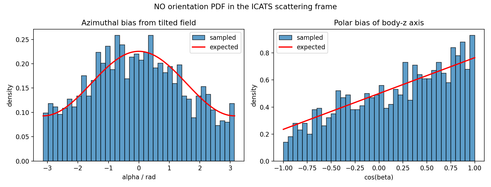

# Tutorials

Tutorials are small, reproducible examples that exercise different parts of the
program. They teach the workflow and catch common setup mistakes; a short smoke
run is not a statistically converged scattering calculation.

List available tutorials:

```bash
icats --list-tutorials
```

Generate a named tutorial:

```bash
icats --tutorial single_atom_diatom_he_n2 --setup-only
```

Current tutorials cover:

- `quickstart`: NH3 + H2O baseline workflow.
- `revision_nh3_h2o`: corrected thermal rotor populations and interval smoothing,
  with geometric orbital sampling and ensemble statistics.
- `diatomic_n2_n2_fast`: fast N2 + N2 environment sanity check.
- `mixed_h2o_n2`: mixed rotor types.
- `methane_methane`: spherical-top example.
- `single_atom_he_he`: atom-atom edge case.
- `single_atom_diatom_he_n2`: atom-diatom template.
- `polarized_orientation_he_no`: user-supplied molecular orientation PDF.
- `fixed_plane_atom_diatom_ar_no`: fixed collision geometry with rigid NO.
- `flat_l_atom_diatom_ar_no`: uniform orbital proposal and its area weighting.
- `thermal_atom_diatom_ar_no`: thermal rigid NO with geometric orbital sampling.
- `npz_output_co2_co2`: dual xyz/vel and NPZ output.
- `he_nh3_state_selected`: fixed-state NH3 + He preparation and analytic-model
  dynamics; see the generated README for commands and quantum reference data.

The Wang-Landau tutorials and the old `paper_nh3_h2o_100k` workflow are retired.
Their checkpoints and stored reference data must not be reused for the revised
sampler. Start in a new directory. Use tutorial names rather than numeric
indices, which can change when examples are removed.

## Recommended Learning Order

1. `single_atom_he_he`: intermolecular motion without molecular rotation.
2. `single_atom_diatom_he_n2`: one linear rotor and angular-momentum output.
3. `quickstart`: two polyatomic molecules and the complete file pipeline.
4. `revision_nh3_h2o`: thermal populations, moment-preserving rotor sampling
   and comparisons with quantum channel counts.
5. `polarized_orientation_he_no`: a specified orientation distribution.
6. `flat_l_atom_diatom_ar_no`: proposal sampling versus cross-section weights.
7. `he_nh3_state_selected`: model dynamics and final-state analysis.

## Revised NH3 + H2O Preparation

```bash
icats --tutorial revision_nh3_h2o --setup-only
cd tutorial_revision_nh3_h2o
icats.init tutorial_input.txt
```

This short example uses the corrected canonical rotor populations, within-K-
interval smoothing and moment-matched azimuths. It keeps the coupled total-J
tail rather than forcing the histogram to be proportional to 2J+1 alone.
Read `rd_tutorial_input/convergence/ensemble_statistics.txt` and the associated
CSV tables. Finite-sample residuals should be interpreted with their statistical
uncertainties, not as exact identities for every trajectory.

The paper figures use a separate, saved 100,000-sample NH3 + H2O ensemble.
Figures 7, 9 and 10 share that ensemble; Figure 8 contains separate fixed-state
angular comparisons. The revised supporting-data workflow is being packaged;
the short preparation above is not a claim to reproduce those exact figures.
The old WL export scripts and profiles are not the revised paper workflow.

## Running A Tutorial

The standard pattern is:

```bash
icats --tutorial quickstart --setup-only
cd tutorial_quickstart
icats.init tutorial_input.txt
./run_cheap_dynamics.sh
./run_analysis.sh
```

To generate fewer samples for a fast test:

```bash
icats --tutorial quickstart --nsamp 2 --ntraj 1 --setup-only
```

Before running `icats.init`, inspect the frame convention in
`tutorial_input.txt`:

```text
output-frame = internal
```

This is the historical ICATS/tutorial convention. If the generated xyz/vel
files must match a scattering or QM input convention where the incoming
relative wave vector is along space-fixed `+Z`, change the line before
generation:

```text
output-frame = incoming-k-plus-z
```

Changing `output-frame` changes Cartesian components and SF/BF Euler angles, so
regenerate the samples after changing it. Magnitudes and energies are unchanged.

## What To Inspect

After `icats.init`, inspect:

```text
tutorial_input.txt.logfile
rd_tutorial_input/
rd_tutorial_input/outputs/
```

After analysis, inspect:

```text
rd_tutorial_input/outputs/dynamics0.analinfo
```

Search for:

```text
[energy summary]
[rotation]
[vibration]
[intermolecular]
```

These blocks are the fastest way to understand what ICATS sampled and what the
analysis reconstructed.

## Constrained Ar + NO Tutorial

Use this tutorial when you want a small setup that fixes selected variables
instead of sampling the full intermolecular geometry:

```bash
icats --tutorial fixed_plane_atom_diatom_ar_no --setup-only
cd tutorial_fixed_plane_atom_diatom_ar_no
icats.init tutorial_input.txt
```

The generated input uses:

```text
Trot = 0.0
Tvib = 0.0
vib-mode = rigid
incoming-k = 13.615392
fixed-b = 4.5
impact-phi = 0.0
output-frame = internal
printout = 1 1 0 0
```

This freezes the NO bond at the reference geometry, starts the diatom with no
rigid-rotor angular momentum, fixes the impact parameter and lab impact-plane
azimuth, and still samples the NO bond orientation. Inspect `out_full.info`,
`out_full.xyz`, and `out_full.vel` after `icats.init`.

This tutorial is an initial-condition/export example, not a cheap-MINDO
dynamics example. The PySCF MINDO/3 backend used by `run_cheap_dynamics.sh`
does not support Ar for this setup, so use the generated files for inspection
or pass them to an external dynamics/QM code.

## Polarized NO Orientation Tutorial

Use this tutorial to test a user-supplied molecular orientation PDF. The
example is intentionally simple: He is an atom, NO is rigid and non-rotating,
and the main diagnostic is the biased NO orientation.

```bash
icats --tutorial polarized_orientation_he_no --setup-only
cd tutorial_polarized_orientation_he_no
icats.init tutorial_input.txt
python rd_tutorial_input/histograms/plot_polarization_check.py
```

The generated NO molecule file contains:

```text
orientation-mode = pdf orientation_pdfs.py dipole_field_tilted 0.75 0.7853981633974483 0.0
orientation-frame = scattering
orientation-thin = 100
rot-param = euler
```

The referenced function has the form:

```python
def dipole_field_tilted(alpha, beta, gamma, strength, field_theta, field_phi):
    ...
```

It treats the NO body-fixed `z` axis as a toy dipole and the field direction as
already expressed in the ICATS scattering frame. The example field is tilted by
`pi/4`, so the sampled distribution depends on both `alpha` and `beta`. ICATS
multiplies the user PDF by the Euler measure `sin(beta)`, so the user function
should return only the physical angular weight. In particular, the example
function computes the body-axis direction from the supplied Euler angles, takes
its dot product with the field axis, and returns a non-negative value
proportional to `1 + A cos(theta_muE)`.

The plotting helper writes:

```text
rd_tutorial_input/histograms/plots/polarization/polarized_orientation_check.png
```



The left panel compares sampled `alpha` with the expected azimuthal trend. The
right panel compares sampled `cos(beta)` with the expected linear trend. With
the default tutorial sample count the curves are not production-smooth, but the
tilt and sign should be visible. Increase `Nsamp` if you want a cleaner
diagnostic plot.

## Flat-L Ar + NO Tutorial

Use this tutorial when you want to oversample the small-impact-parameter region
without running Wang-Landau. The default geometric orbital proposal samples
impact parameter area, so `P(b) db ~ b db` and `P(ell) d ell ~ ell d ell`
at fixed incoming momentum. That is the natural choice for direct geometric
averages, but it can leave relatively few samples at small `b`.

The flat-L tutorial deliberately changes only that proposal:

```bash
icats --tutorial flat_l_atom_diatom_ar_no --setup-only
cd tutorial_flat_l_atom_diatom_ar_no
icats.init tutorial_input.txt
```

The generated input contains:

```text
Trot = 0.0
Tvib = 0.0
vib-mode = rigid
incoming-k = 13.615392
maxb = 8.0
impact-phi = 0.0
output-frame = internal
orbital-sampling = flat-l
wang = False
printout = 0 1 0 0
```

As above, this Ar + NO tutorial is not compatible with the bundled
`run_cheap_dynamics.sh` MINDO helper, because PySCF MINDO/3 does not support Ar
for this setup. It is intended for initial-condition diagnostics and histogram
inspection.

Here `orbital-sampling = flat-l` means ICATS proposes `L` uniformly between
zero and the requested upper limit, with magnitude `ell=sqrt(L(L+1))`.
It does not impose a flat physical
cross-section distribution. If you use these samples to estimate a geometric
quantity, reweight by the Jacobian `2L+1` at fixed incoming momentum.
The separate `flat-b` mode is uniform in actual impact parameter and instead
requires a weight proportional to b. See [Theory](theory.md) for the estimators.

This tutorial is intentionally simple. The NO bond is rigid and `Trot = 0.0`,
so the internal rotor contribution is zero: `Jab = 0`. Therefore the total
angular momentum is just `J = L`. That makes it a clean user check: sampled `L`
and sampled `J` should both look roughly flat.

To make histogram helper scripts at setup time:

```bash
icats --tutorial flat_l_atom_diatom_ar_no --histograms --hist-samples 5000 --setup-only
cd tutorial_flat_l_atom_diatom_ar_no
icats.init tutorial_input.txt
mkdir -p rd_tutorial_input/histograms/plots/sampled
python rd_tutorial_input/histograms/sampled/system/hist_sam_sys_orb_sl.py \
  --no-show --outfile rd_tutorial_input/histograms/plots/sampled/hist_sam_sys_orb_sl
python rd_tutorial_input/histograms/sampled/system/hist_sam_sys_orb_sj.py \
  --no-show --outfile rd_tutorial_input/histograms/plots/sampled/hist_sam_sys_orb_sj
```

Inspect the resulting system `L` and `J` plots under:

```text
rd_tutorial_input/histograms/plots/sampled/
```

The broader `plot_sampled.sh` helper is still available, but it plots every
sampled histogram. For this diagnostic tutorial the two system orbital plots
above are usually the useful check.

For this tutorial the important lesson is the shape of the proposal
distribution. It is not a Wang-Landau run, and it is not a replacement for
checking whether the requested `maxb`, `maxl`, and incoming momentum are
appropriate for the physical calculation.
